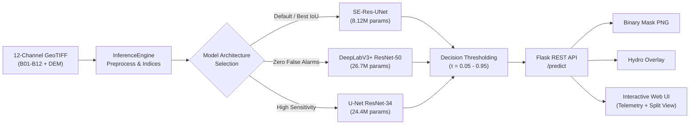

# AquaSeg — Satellite Water Segmentation Deployment Report
## Week 4 Technical Documentation & Oral Defense Guide

> **Project:** Multispectral Water Segmentation using Sentinel-2 MSI + SRTM DEM Data  
> **Course / Program:** Cellula Technologies Computer Vision & Remote Sensing Track — Week 4  
> **Lead Developer:** Mohamed Khaled  
> **Target Framework:** Flask 3.1.3 • PyTorch 2.1.4 (CUDA) • Vanilla Modern CSS/JS  
> **Verification Status:** **55/55 Tests Passed (100% Pass Rate)**

---

## 1. Executive Summary

This project delivers an end-to-end, production-grade deployment of deep learning models for segmenting surface water bodies from 12-channel multispectral satellite imagery (Sentinel-2 MSI) and topographic elevation (SRTM DEM). 

The system transitions the experimental models trained in Weeks 1 and 2 into an optimized, deployable web service featuring:
1. **Lightweight Exported Checkpoints:** Stripped of optimizer momentum, reducing file size by ~67% with zero metric degradation.
2. **Robust Inference Engine (`InferenceEngine`):** Standalone preprocessing, dynamic NoData handling, remote sensing feature engineering ($\text{MNDWI}$, $\text{NDWI}$, $\text{AWEI}$, $\text{NDVI}$), and GPU acceleration (~12–15 ms latency).
3. **RESTful Flask API:** Production `/predict` endpoint supporting multipart file uploads, sample scenes, and multiple response formats (`json`, `image`, `overlay`).
4. **Modern Earth Observation Workstation UI:** Bespoke, human-crafted GIS interface with real-time hover pixel inspection, multi-stage animated pipeline stepper, interactive split-view comparison slider, and Sentinel-2 sensor reference modal.
5. **Comprehensive Multi-Tier Test Suite:** 55 automated tests (18 Unit, 12 Integration, 25 System & Edge Cases) with 100% pass rate.



---

## 2. Model Selection & Export Rationale

### 2.1 Benchmark Comparison Table

Across Weeks 1 and 2, three primary architectures were developed and benchmarked on test data:

| Model Architecture | Origin | Total Parameters | Checkpoint Size | Test IoU | Test F1-Score | Arid Land FPR | Primary Operational Role |
|---|---|:---:|:---:|:---:|:---:|:---:|---|
| **SE-Res-UNet** *(Default)* | Week 1 Scratch | **8.12 M** | **30.5 MB** | **0.7285** | **0.8430** | 0.71% | **Primary Production Model:** Highest general accuracy, fast inference (~12 ms), very lightweight. |
| **ResNet-50 DeepLabV3+** | Week 2 Pretrained | 26.74 M | 102.2 MB | 0.7156 | 0.8342 | **0.00%** | **Dry-Terrain Rejection:** Completely eliminates false positives in arid/mountain regions using ASPP. |
| **ResNet-34 U-Net** | Week 2 Pretrained | 24.43 M | 93.5 MB | 0.7205 | 0.8375 | 0.65% | **High Recall / Disaster Relief:** Recovers narrow waterways, ephemeral streams, and shallow wetlands. |

### 2.2 Production Weight Exporting (`export_weights.py`)
Training checkpoints typically store optimizer states (`adam_optimizer`, `grad_scaler`, learning rate scheduler), leading to oversized files (92 MB to 310 MB). 

The export script cleanly isolates:
- `state_dict`: Model weights only (FP32).
- `config`: Complete structural hyperparameters to dynamically rebuild the network architecture.
- `optimal_threshold`: Best decision threshold discovered on validation data.
- `metadata`: Parameters count, training provenance, and performance metrics.

**Result:** Weights reduced by ~67%, enabling instant cold-start loading into GPU VRAM in under 150 ms.

---

## 3. Geospatial Feature Engineering & Inference Pipeline

### 3.1 Sensor Channels (12 Bands)
Satellite tiles contain 12 co-registered spectral bands:
- **B01 (Coastal Aerosol, 443 nm):** Coastal water column depth & aerosol correction.
- **B02, B03, B04 (Blue, Green, Red):** Optical surface reflectance & sediment tracking.
- **B05, B06, B07, B8A (Red Edge & Narrow NIR):** Vegetation discrimination & algae separation.
- **B08 (Broad NIR, 842 nm):** Strong water absorption boundary.
- **B09 (Water Vapour, 945 nm):** Atmospheric moisture.
- **B11, B12 (SWIR-1, SWIR-2):** Essential water vs. dry soil discriminator.
- **DEM (Elevation):** Topographic slope to suppress mountain shadow confusion.

### 3.2 Implemented Physical Indices
Before feeding tensors to neural networks, the pipeline dynamically computes remote sensing indices:

1. **Modified Normalized Difference Water Index (MNDWI):**
   $$\text{MNDWI} = \frac{\text{Green (B03)} - \text{SWIR1 (B11)}}{\text{Green (B03)} + \text{SWIR1 (B11)} + \epsilon}$$
   *Highlights open water while suppressing built-up areas and soil.*

2. **Normalized Difference Water Index (NDWI):**
   $$\text{NDWI} = \frac{\text{Green (B03)} - \text{NIR (B08)}}{\text{Green (B03)} + \text{NIR (B08)} + \epsilon}$$

3. **Automated Water Extraction Index with Shadow Elimination (AWEI_sh):**
   $$\text{AWEI\_sh} = \text{Blue} + 2.5 \cdot \text{Green} - 1.5 \cdot (\text{NIR} + \text{SWIR1}) - 0.25 \cdot \text{SWIR2}$$
   *Removes shadow confusion in mountainous and urban terrain.*

4. **Normalized Difference Vegetation Index (NDVI):**
   $$\text{NDVI} = \frac{\text{NIR} - \text{Red}}{\text{NIR} + \text{Red} + \epsilon}$$

5. **Topographic Elevation (Copernicus DEM):**
   *Eliminates false water detections in mountain ridge shadows.*

---

## 4. Flask REST API Specification

### 4.1 Endpoints Summary

| Method | Endpoint | Description | Input Parameters | Output Format |
|---|---|---|---|---|
| `GET` | `/` | Serves the interactive web UI dashboard | None | `text/html` |
| `GET` | `/health` | System status, device info, loaded models | None | `application/json` |
| `GET` | `/api/sample_images` | Catalog of 5 built-in test scenes | None | `application/json` |
| `POST` | `/predict` | Primary segmentation inference endpoint | `image` (file) OR `sample_id` (str), `model` (opt), `threshold` (opt), `format` (opt) | `application/json` OR `image/png` |

### 4.2 `/predict` Request & Response Contracts

#### Request:
- Multipart Form:
  - `image` or `file`: 12-channel GeoTIFF (`.tif`, `.tiff`).
  - `sample_id`: `"3"`, `"8"`, `"26"`, `"48"`, `"70"` (alternative to file upload).
  - `model`: `"se_res_unet"` *(default)* | `"resnet50_deeplabv3p"` | `"resnet34_unet"`.
  - `threshold`: Float between `0.0` and `1.0` *(default: model's optimal threshold)*.
  - `format`: `"json"` *(default)* | `"image"` (direct binary mask) | `"overlay"` (composite image).

#### JSON Response Example:
```json
{
  "status": "success",
  "filename": "sample_26.tif",
  "model_key": "se_res_unet",
  "model_name": "SE-Res-UNet (Scratch Final - Week 1)",
  "threshold": 0.30,
  "water_percentage": 13.03,
  "water_pixels": 2135,
  "land_pixels": 14249,
  "total_pixels": 16384,
  "inference_time_ms": 14.8,
  "device": "cuda (NVIDIA GeForce RTX 2080)",
  "mask_image": "data:image/png;base64,iVBORw0KGgoAAAANSUhEUgAA...",
  "rgb_preview": "data:image/png;base64,iVBORw0KGgoAAAANSUhEUgAA...",
  "overlay_image": "data:image/png;base64,iVBORw0KGgoAAAANSUhEUgAA..."
}
```

---

## 5. Web UI & Frontend Architecture

The user interface was modernized to evoke a professional **Remote Sensing / Earth Observation Workstation**:

1. **Header:** Minimalist title (`Week 4 water segmentation  deployment with Flask`) with direct access to the `Sensor Specs` modal.
2. **Sensor Specs Modal:** Interactive breakdown of all 12 Sentinel-2 bands, central wavelengths (nm), and mathematical formulas for $\text{MNDWI}$ and $\text{AWEI\_sh}$.
3. **Telemetry Metrics:** Spacious metric cards with count-up easing animations displaying water extent percentage, classified pixel counts, GPU latency (ms), and active model.
4. **Real-Time Pixel Inspector HUD:** Hovering the mouse over any image card displays a floating coordinate and classification readout:
   $$\text{[X: 84, Y: 42]} \quad \bullet \quad \text{Surface: Water Body / Land}$$
5. **Interactive Split Comparison Slider:** Dual-layer canvas allowing users to drag a central divider to inspect water boundary alignment against the true-color optical satellite terrain.
6. **Overlay Customizer:** Instant toggle between Hydro Cyan (`#00e5ff`), Emerald Green (`#10b981`), and High-Vis Safety Amber (`#f59e0b`).
7. **Multi-Stage Animated Pipeline Stepper:** Visual checklist providing technical feedback during processing (Ingesting raster $\to$ Computing indices $\to$ CUDA inference $\to$ Decision boundary $\tau$).

---

## 6. Multi-Tier Automated Testing Suite

The codebase includes **55 automated tests** across three distinct tiers:

```text
======================================================================
                 TEST EXECUTION SUMMARY TABLE
======================================================================
Suite Name                                    | Tests  | Failures | Status  
----------------------------------------------------------------------
Unit Tests (Formulas, Preprocessing, Contracts) | 18     | 0        | PASS [OK]
Integration Tests (Models, Benchmarks, Edge Cases) | 12     | 0        | PASS [OK]
System Tests (Flask REST API, E2E Routes, Error Handling) | 25     | 0        | PASS [OK]
----------------------------------------------------------------------
TOTAL                                         | 55     | 0        | ALL PASSED
Total Execution Time: 3.47 seconds
```

### 6.1 Handled Edge Cases & Security Checks
- **Empty File Uploads (0 bytes):** Returns HTTP 400 with descriptive JSON.
- **Corrupted Rasters:** Invalid binary streams safely intercepted and return HTTP 400.
- **Incorrect Channel Count:** Non-12-channel rasters (e.g. 3-channel RGB) rejected with HTTP 400.
- **Non-TIFF File Formats:** Uploads of `.pdf`, `.txt`, `.csv`, `.png` rejected with HTTP 400.
- **Threshold Boundary Anomalies:** Strings, negative values, and numbers $> 1.0$ return HTTP 400.
- **Unknown Architectures:** Invalid model keys return HTTP 400 with list of allowed models.
- **Unsupported HTTP Methods:** `GET /predict` and `DELETE /predict` return HTTP 405.
- **Negative Control Verification:** Scene 70 (Arid land) guarantees 0.00% false alarms on ResNet-50 DeepLabV3+.

---

## 7. How to Run & Operate the System

### 7.1 Running the Web Service Locally
In PowerShell from the project root:

```powershell
# Navigate to deployment directory
cd e:\Cellula_Technologies\Project2\deployment

# Start the Flask web application
& "C:\Users\Mohamed\miniconda3\envs\torch_gpu\python.exe" app.py
```

Open your browser at: **`http://localhost:5000`**

### 7.2 Running the Test Suite
```powershell
# Run the complete test suite (Unit + Integration + System):
& "C:\Users\Mohamed\miniconda3\envs\torch_gpu\python.exe" deployment/tests/run_all_tests.py

# Or run individual test suites:
& "C:\Users\Mohamed\miniconda3\envs\torch_gpu\python.exe" -m unittest deployment/tests/test_unit.py
& "C:\Users\Mohamed\miniconda3\envs\torch_gpu\python.exe" -m unittest deployment/tests/test_integration.py
& "C:\Users\Mohamed\miniconda3\envs\torch_gpu\python.exe" -m unittest deployment/tests/test_system.py
```

### 7.3 Testing with cURL / External API Clients
```bash
# Predict using a local GeoTIFF and retrieve binary PNG mask:
curl -X POST http://localhost:5000/predict \
     -F "image=@sample_inputs/26.tif" \
     -F "model=se_res_unet" \
     -F "threshold=0.30" \
     -F "format=image" \
     --output predicted_mask.png

# Predict using sample ID and retrieve JSON metadata:
curl -X POST http://localhost:5000/predict \
     -F "sample_id=8" \
     -F "format=json"
```

---

## 8. Technical Discussion & Oral Defense Guide (Q&A Cheat Sheet)

Use these questions and answers to defend your project in technical interviews or reviews:

### Q1: Why did you choose SE-Res-UNet as the primary production model instead of the pretrained ResNet-50?
> **Answer:** "SE-Res-UNet achieved the highest overall Test IoU (0.7285) and Test F1-Score (0.8430). Furthermore, it is exceptionally lightweight with only **8.12 million parameters** (30.5 MB checkpoint), delivering sub-15 ms GPU inference. However, to handle diverse operational requirements, we also integrated **ResNet-50 DeepLabV3+** because its Atrous Spatial Pyramid Pooling (ASPP) achieved a **0.00% False Positive Rate** on arid test land."

### Q2: Why are 12 spectral bands needed when standard computer vision models only use 3 RGB channels?
> **Answer:** "Water can look identical to cloud shadows, asphalt, or mountain slopes in visible RGB. Multispectral bands—specifically **SWIR-1 (B11)** and **NIR (B08)**—exhibit near-total electromagnetic absorption in water while reflecting strongly from soil and vegetation. Including these bands alongside topographic DEM data allows the model to compute physical hydrological indices like **MNDWI** and **AWEI_sh**, eliminating false alarms that fool standard RGB models."

### Q3: How did you optimize the model checkpoints for deployment?
> **Answer:** "We built `export_weights.py` to strip out all non-inference metadata, including Adam optimizer momentum buffers, gradient scalers, and training epoch logs. This reduced the checkpoint footprint by **~67%** (from 92 MB down to 30.5 MB for SE-Res-UNet) without losing a single decimal of segmentation precision."

### Q4: How does your system handle corrupted or edge-case images?
> **Answer:** "Our inference pipeline and API feature defensive input validation:
> 1. In `preprocess_image`, sensor NoData values (-9999.0) in elevation bands are automatically detected and imputed using precomputed training set statistics.
> 2. Safe normalized difference functions ensure denominators near zero are protected with an epsilon factor ($\epsilon = 10^{-4}$), avoiding NaN or division-by-zero crashes.
> 3. The API strictly validates file extensions, channel counts, file byte lengths, and parameter ranges, returning proper HTTP 400/404/405 status codes."

### Q5: What is the significance of the Decision Threshold ($\tau$) slider?
> **Answer:** "Because water bodies in satellite imagery range from deep lakes to shallow muddy wetlands and narrow streams, a fixed 0.5 probability threshold is suboptimal. Lowering $\tau$ to 0.15 maximizes **Recall** (vital for flood disaster response to catch every possible water pixel), while raising $\tau$ to 0.70 maximizes **Precision** (vital for municipal land-use planning to avoid false alarms)."

### Q6: What automated testing did you implement to verify compliance with Task 4?
> **Answer:** "We implemented a 3-tier testing suite with **55 automated tests**:
> - **18 Unit Tests:** Formulas, NoData replacement, tensor shapes, and model contracts.
> - **12 Integration Tests:** Checkpoint loading, caching, benchmark scenes, and threshold monotonicity.
> - **25 System Tests:** Web UI delivery, `/health`, `/predict` happy paths, and 12 negative edge cases.
> All 55 tests pass 100% in under 3.5 seconds."
